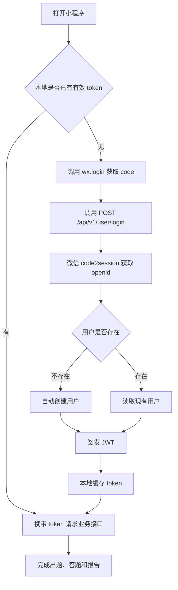
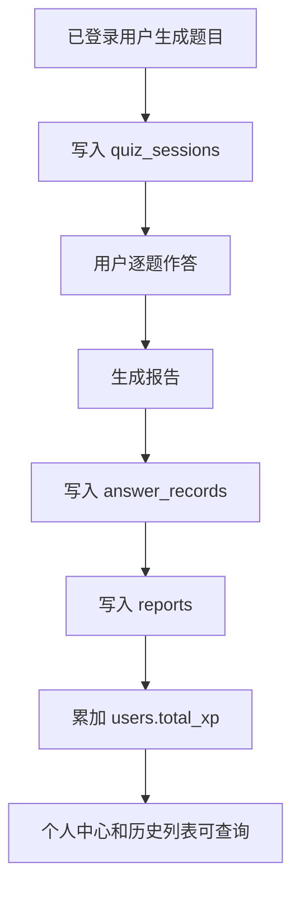

# 《AI智学》用户系统需求分析文档（自己版本）

> 文档状态：扩展阶段需求基线  
> 编写日期：2026-10-19  
> 代码基线：`4337ced feat: add AI learning MVP project`  
> 适用阶段：核心 MVP 之后的用户系统一期  
> 范围原则：核心 MVP 已经实现且本阶段不覆盖的功能，不重复设计和开发。

---

## 1. 文档定位

本文档用于指导核心 MVP 之后的用户系统建设，重点补齐以下能力：

1. 用户身份识别与登录态。
2. 闯关、答题和报告的云端持久化。
3. 用户档案和个人中心。
4. 历史闯关列表、详情和报告回看。

本文档不重新定义核心 MVP 的“输入内容 -> AI 出题 -> 用户答题 -> 复盘报告”主流程，只在主流程的关键节点增加用户关联、数据落库和历史查询能力。

---

## 2. 当前核心 MVP 基线

当前代码已经完成以下能力：

| 能力 | 当前实现 | 本阶段处理 |
|---|---|---|
| 文本输入 | 首页支持一句话或一段文本输入，限制 500 字 | 保留，不重做 |
| 内容过滤 | 后端具备敏感词和风险内容拦截 | 保留，不重做 |
| AI 出题 | 固定生成 5 题：3 单选、1 多选、1 判断 | 保留，不重做 |
| 题目质量校验 | 校验题型、选项、答案引用和知识讲解 | 保留，不重做 |
| 答题交互 | 单选、多选、判断题逐题作答 | 保留，不重做 |
| 即时讲解 | 每题提交后展示答案和解释 | 保留，不重做 |
| 服务端判题 | 后端根据题目答案重新计算正确率、XP、知识币和连击 | 保留，不重做 |
| 复盘报告 | 生成正确率、知识点、薄弱点和学习建议 | 保留，仅增加持久化 |
| 当前闯关本地缓存 | 小程序本地保存当前一次 `RunState`，支持页面恢复 | 保留，不改为历史记录 |
| 分享海报 | 已支持 Canvas 生成、保存相册和微信转发 | 保留，不重做 |
| H5/小程序双端 | 当前工程支持 H5 和微信小程序构建 | 保留，不重做 |

### 2.1 当前代码与旧文档的差异

1. 当前首页没有“小皮”“602 金币”等硬编码用户信息，因此本阶段不是替换假数据，而是在需要时新增真实用户展示。
2. 当前没有“我的”或“个人中心”页面，需要新增页面，而不是改造已有占位页面。
3. 当前本地缓存只保存正在进行的这一次闯关，不包含历史列表，不能作为闯关历史使用。
4. 当前报告页只读取本次本地 `RunState`，没有按 `quiz_id` 查询历史报告的入口。

---

## 3. 本阶段目标

### 3.1 用户价值

1. 用户再次进入小程序时可以识别同一身份。
2. 完成闯关后，题目、答题记录和报告不再随页面关闭而丢失。
3. 用户可以在个人中心查看真实昵称、累计 XP、闯关次数和正确率。
4. 用户可以回看历史闯关及对应报告。

### 3.2 系统目标

1. 建立微信静默登录和 JWT 鉴权基础设施。
2. 使用 MySQL 持久化用户、闯关、答题和报告数据。
3. 保持匿名模式可用，避免登录失败阻断核心体验。
4. 为后续错题本、复习计划、排行榜等能力保留清晰的数据边界。

---

## 4. 范围边界

### 4.1 本阶段范围内

1. MySQL 用户系统表结构及迁移。
2. 微信 `wx.login()` 静默登录。
3. JWT 签发、校验和可选鉴权。
4. 出题结果持久化。
5. 答题记录和报告持久化。
6. 用户累计 XP 更新。
7. 用户档案查询与修改。
8. 个人中心和首页真实用户信息展示。
9. 历史闯关列表、详情和报告回看。

### 4.2 核心 MVP 已实现，本阶段不覆盖

| 功能 | 不覆盖原因 |
|---|---|
| AI 出题和题型分配 | 核心闭环已实现，只需在返回前增加可选持久化 |
| 答案校验和讲解生成 | 核心闭环已实现，不修改题目结构 |
| 正确率、连击、单次 XP 和知识币计算 | 核心闭环已实现，本阶段复用现有结果 |
| AI 复盘报告内容生成 | 核心闭环已实现，只增加报告落库和历史读取 |
| 当前一次闯关的本地缓存 | 已满足当前流程恢复，不作为历史数据方案 |
| 分享海报生成、保存和转发 | 核心 MVP 已实现，本阶段不改造 |
| 文本输入、内容过滤和错误重试 | 核心闭环已实现，不重做 |

### 4.3 明确留到后续迭代

1. 社交 PK 和排行榜。
2. 错题本和艾宾浩斯复习。
3. PDF、Word、URL、视频等多源输入。
4. RAG 私有知识库。
5. VIP、支付和商业化。
6. 图片、语音等多模态题目。
7. 头像文件上传。
8. 知识币的云端累计和消费。

---

## 5. 用户角色与主流程

### 5.1 用户角色

| 角色 | 能力 |
|---|---|
| 匿名用户 | 可以完成核心出题、答题和报告流程，不产生云端历史 |
| 已登录用户 | 在匿名能力基础上，拥有云端历史、个人档案和累计 XP |

### 5.2 登录主流程



### 5.3 持久化主流程



---

## 6. 功能需求

### 6.1 批次一：用户登录与鉴权

#### 6.1.1 MySQL 数据库初始化

| 编号 | 需求 | 端 |
|---|---|---|
| 1.1 | 创建 `users`、`quiz_sessions`、`answer_records`、`reports` 四张业务表 | 后端 |
| 1.2 | 使用 Alembic 管理数据库版本，并保留 `alembic_version` | 后端 |
| 1.3 | 数据库字符集使用 `utf8mb4`，核心查询字段建立索引 | 后端 |

#### 6.1.2 微信登录

| 编号 | 需求 | 端 |
|---|---|---|
| 1.4 | 提供 `POST /api/v1/user/login`，接收 `wx.login()` 返回的 code | 后端 |
| 1.5 | 服务端调用微信 `jscode2session` 获取 openid，不向前端暴露 AppSecret | 后端 |
| 1.6 | openid 首次出现时自动创建用户，昵称使用默认值 | 后端 |
| 1.7 | 登录成功返回 JWT 和基础用户信息 | 后端 |

#### 6.1.3 鉴权

| 编号 | 需求 | 端 |
|---|---|---|
| 1.8 | 从 `Authorization: Bearer <token>` 中解析 JWT | 后端 |
| 1.9 | 用户档案和历史接口要求有效登录态 | 后端 |
| 1.10 | 出题和报告接口使用可选鉴权：有 token 时关联用户，无 token 时匿名可用 | 后端 |
| 1.11 | token 过期或无效时返回统一未授权错误 | 后端 |

#### 6.1.4 前端登录态

| 编号 | 需求 | 端 |
|---|---|---|
| 1.12 | App 启动时检查本地 token，缺失时执行静默登录 | 前端 |
| 1.13 | token 和基础用户信息保存到本地缓存 | 前端 |
| 1.14 | 统一请求层自动添加 Authorization header | 前端 |
| 1.15 | 401 时清理失效 token，并允许重新登录或降级为匿名模式 | 前端 |

#### 批次验收

1. 小程序启动后可自动完成登录，并缓存有效 token。
2. 新用户首次登录后可在 `users` 表中查到记录。
3. 业务请求可以携带 token，匿名请求仍可完成核心流程。

---

### 6.2 批次二：闯关数据持久化

#### 6.2.1 出题结果落库

| 编号 | 需求 | 端 |
|---|---|---|
| 2.1 | 保持 `POST /api/v1/quiz/generate` 的现有请求和响应结构 | 前后端 |
| 2.2 | 有登录态时，将 `quiz_id`、标题、摘要、原始输入和题目 JSON 写入 `quiz_sessions` | 后端 |
| 2.3 | 匿名请求不写数据库，但仍正常返回题目 | 后端 |

#### 6.2.2 答题和报告落库

| 编号 | 需求 | 端 |
|---|---|---|
| 2.4 | 保持 `POST /api/v1/report/generate` 的现有报告生成逻辑 | 前后端 |
| 2.5 | 有登录态时，将完整答题记录写入 `answer_records` | 后端 |
| 2.6 | 将完整报告 JSON 写入 `reports` | 后端 |
| 2.7 | 在同一事务内累加 `users.total_xp` | 后端 |
| 2.8 | 同一个 `quiz_id` 重复提交时不得重复创建答题、报告记录或重复累加 XP | 后端 |

#### 6.2.3 前端数据提交

| 编号 | 需求 | 端 |
|---|---|---|
| 2.9 | 报告请求继续提交完整题目、`quiz_id` 和全部答题记录 | 前端 |
| 2.10 | 不修改现有答题交互和报告展示结构 | 前端 |

#### 批次验收

1. 登录用户完成闯关后，`quiz_sessions`、`answer_records`、`reports` 中均有对应记录。
2. 用户总 XP 增加，且同一闯关不会重复累加。
3. 无 token 时核心流程仍可完成，数据库不产生该次记录。

---

### 6.3 批次三：用户档案与个人中心

#### 6.3.1 用户档案接口

| 编号 | 需求 | 端 |
|---|---|---|
| 3.1 | 提供 `GET /api/v1/user/profile` | 后端 |
| 3.2 | 返回昵称、头像 URL、累计 XP、闯关次数、累计答对题数和平均正确率 | 后端 |
| 3.3 | 未登录或 token 无效时返回未授权错误 | 后端 |

#### 6.3.2 更新用户信息

| 编号 | 需求 | 端 |
|---|---|---|
| 3.4 | 提供 `PUT /api/v1/user/profile` | 后端 |
| 3.5 | 支持更新昵称和头像 URL | 前后端 |
| 3.6 | 昵称和头像 URL 必须进行长度、空值和格式校验 | 前后端 |

#### 6.3.3 页面展示

| 编号 | 需求 | 端 |
|---|---|---|
| 3.7 | 新增个人中心页面，展示真实头像、昵称和统计卡 | 前端 |
| 3.8 | 支持修改昵称，保存成功后刷新当前页面 | 前端 |
| 3.9 | 首页增加真实昵称和累计 XP 展示 | 前端 |

说明：当前首页没有硬编码用户信息，因此 3.9 属于新增展示，不属于替换假数据。

#### 批次验收

1. 个人中心展示的统计与数据库记录一致。
2. 修改昵称后重新进入页面仍能看到新昵称。
3. 完成新闯关后，首页和个人中心统计自动更新。

---

### 6.4 批次四：闯关历史与报告回看

#### 6.4.1 历史列表

| 编号 | 需求 | 端 |
|---|---|---|
| 4.1 | 提供 `GET /api/v1/user/quizzes?page=1&page_size=10` | 后端 |
| 4.2 | 按创建时间倒序分页返回闯关记录 | 后端 |
| 4.3 | 列表项至少包含 `quiz_id`、标题、正确率、题目数和创建时间 | 后端 |

#### 6.4.2 历史详情

| 编号 | 需求 | 端 |
|---|---|---|
| 4.4 | 提供 `GET /api/v1/user/quizzes/{quiz_id}` | 后端 |
| 4.5 | 返回本次闯关的完整题目、答题记录和报告 | 后端 |
| 4.6 | 只能查询当前登录用户自己的闯关记录 | 后端 |

#### 6.4.3 页面展示

| 编号 | 需求 | 端 |
|---|---|---|
| 4.7 | 个人中心底部展示历史闯关列表 | 前端 |
| 4.8 | 列表展示标题、正确率、完成时间和题数 | 前端 |
| 4.9 | 点击历史记录进入报告页并加载对应历史详情 | 前端 |
| 4.10 | 首页“已完成关卡”区域展示真实历史记录 | 前端 |

说明：当前首页没有“已完成关卡”区域，本阶段按新增区域处理；如首页空间不足，可只展示最近 3 条并提供“查看全部”入口。

#### 批次验收

1. 个人中心可以分页查看历史闯关，最近记录排在前面。
2. 点击历史记录可以打开对应报告，不依赖本地当前 `RunState`。
3. 首页可以展示真实历史记录，而不是固定占位内容。

---

## 7. 关键业务规则

### 7.1 XP 规则

1. 单次闯关的 XP 继续以核心 MVP 的 `report.xp_reward` 为准。
2. 每完成一次有效报告生成，将该次 `report.xp_reward` 累加到 `users.total_xp`。
3. 不采用“完成一次 +10 XP，每答对一题 +2 XP”的另一套规则。
4. 知识币目前只保留在单次报告结果中，本阶段不新增云端知识币字段。

### 7.2 匿名兼容

1. 登录不是使用核心闯关功能的前置条件。
2. 匿名用户不写入云端历史。
3. 用户中心和个人历史接口必须登录。

### 7.3 数据幂等

1. `quiz_id` 在 `quiz_sessions` 中唯一。
2. `answer_records` 和 `reports` 每个 `quiz_id` 只保留一条有效记录。
3. 报告接口重复调用时使用更新或幂等返回，不重复累加 XP。

### 7.4 数据归属

1. 所有云端数据必须关联当前 JWT 对应用户。
2. 客户端传入的 `user_id` 不可信，后端统一从 JWT 获取。
3. 历史详情不得允许用户读取他人的 `quiz_id`。

---

## 8. 非功能需求

1. 微信 AppSecret、JWT Secret 和数据库密码只能保存在后端配置，不进入小程序代码或日志。
2. 历史列表默认每页 10 条，最大不超过 50 条。
3. 数据库操作失败时返回明确错误，不返回“保存成功”的假结果。
4. JWT 默认设置有效期，过期后前端重新静默登录。
5. 核心接口保持现有统一响应格式：`{ code, message, data }`。
6. 当前 H5 环境无法完成真实微信登录时，保留匿名核心流程；个人中心和历史能力以微信小程序验收为主。
7. 新增功能不得破坏核心 MVP 的题型、判题、报告和分享流程。

---

## 9. 开发顺序

1. 数据库配置、迁移和表结构。
2. 微信登录、JWT 和可选鉴权。
3. 出题与报告持久化。
4. 用户档案接口。
5. 个人中心和首页用户信息。
6. 历史列表、详情和报告回看。
7. 自动化测试、异常场景和联调验收。

依赖关系：

```text
数据库
  -> 登录与 JWT
  -> 出题/报告持久化
  -> 用户统计
  -> 个人中心
  -> 历史列表与详情
  -> 历史报告回看
```

---

## 10. 最终完成标准

以下条件全部满足时，用户系统一期完成：

- [ ] 小程序可以完成微信静默登录并保存 token。
- [ ] 匿名模式和登录模式都能完成核心闯关流程。
- [ ] 登录用户的闯关、答题和报告写入 MySQL。
- [ ] 同一个闯关不会重复落库或重复累加 XP。
- [ ] 个人中心展示真实用户资料和统计。
- [ ] 首页展示真实昵称、累计 XP 和最近历史。
- [ ] 用户可以分页查看历史闯关并打开历史报告。
- [ ] 用户只能读取自己的数据。
- [ ] 核心 MVP 已实现的出题、判题、报告和分享体验没有回归。
